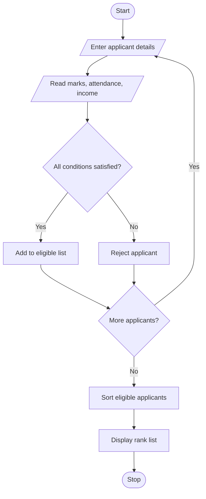

# PROGRAM 1: UNIVERSITY SCHOLARSHIP ALLOCATION
# 1. Problem Statement
Develop a Python program to evaluate university scholarship applicants based on aggregate marks, subject-wise minimum marks, attendance percentage and annual family income.

The program should identify eligible students, rank them according to aggregate marks and resolve ties using attendance percentage.

Eligibility criteria:
- Aggregate marks ≥ 75%.
- Each subject mark ≥ 60%.
- Attendance ≥ 75%.
- Annual family income ≤ ₹2,50,000.
# 2. Algorithm
1. Start.
2. Read the number of applicants.
3. Enter each applicant's name and aggregate marks.
4. Read three subject marks.
5. Read attendance and annual family income.
6. Check all eligibility conditions.
7. Store eligible students in a list.
8. Sort students by aggregate marks in descending order.
9. If aggregate marks are equal, rank by attendance.
10. Display the scholarship ranking.
11. Stop.
# 3. Flowchart (Mermaid)

# 4. Complete Source Code
applicants = []

n = int(input("Enter number of applicants: "))

for i in range(n):
    print("\nApplicant", i + 1)

    name = input("Enter name: ")
    aggregate = float(input("Enter aggregate marks: "))

    subjects = []

    for j in range(3):
        mark = float(input("Enter subject mark: "))
        subjects.append(mark)

    attendance = float(input("Enter attendance: "))
    income = float(input("Enter annual income: "))

    if (aggregate >= 75 and
        min(subjects) >= 60 and
        attendance >= 75 and
        income <= 250000):

        applicants.append(
            (name, aggregate, attendance)
        )
    else:
        print("Not Eligible")

applicants.sort(
    key=lambda x: (x[1], x[2]),
    reverse=True
)

print("\nSCHOLARSHIP RANK LIST")

if len(applicants) == 0:
    print("No eligible applicants")
else:
    for rank, student in enumerate(applicants, 1):
        print(rank, student[0],
              student[1], student[2])

# 5. Sample Input
Enter number of applicants: 3

Applicant 1
Enter name: Ravi
Enter aggregate marks: 85
Enter subject mark: 80
Enter subject mark: 90
Enter subject mark: 85
Enter attendance: 90
Enter annual income: 200000

Applicant 2
Enter name: Sita
Enter aggregate marks: 92
Enter subject mark: 90
Enter subject mark: 95
Enter subject mark: 91
Enter attendance: 85
Enter annual income: 180000

Applicant 3
Enter name: Kumar
Enter aggregate marks: 70
Enter subject mark: 65
Enter subject mark: 70
Enter subject mark: 75
Enter attendance: 80
Enter annual income: 200000
# 6. Sample Output
Not Eligible

SCHOLARSHIP RANK LIST

1 Sita 92.0 85.0
2 Ravi 85.0 90.0
# 7. Screenshot

