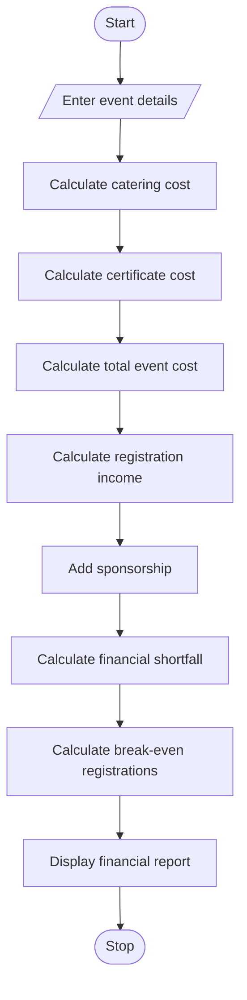

# PROGRAM 10: CAMPUS EVENT FINANCIAL PLANNING
# 1. Problem Statement
Develop a Python program to calculate campus event expenses, including venue, equipment, catering, transport and certificate costs.

Calculate participant contributions, sponsorship shortfalls and the minimum number of registrations required to break even.

Assumed event expenses:
Expense	Amount
Venue	₹10,000
Equipment	₹5,000
Transport	₹3,000
Catering per participant	₹200
Certificate per participant	₹50
Sponsorship	₹5,000
Registration fee	₹300

# 2. Algorithm
1. Start.
2. Read venue, equipment and transport costs.
3. Read sponsorship amount.
4. Read registered participants.
5. Calculate catering expenses.
6. Calculate certificate expenses.
7. Calculate total event cost.
8. Calculate registration income.
9. Calculate total available funds.
10. Calculate financial shortfall.
11. Calculate minimum registrations needed to break even.
12. Display the event financial report.
13. Stop.
# 3. Flowchart (Mermaid)

# 4. Complete Source Code
venue = float(input("Enter venue cost: "))

equipment = float(input("Enter equipment cost: "))

transport = float(input("Enter transport cost: "))

sponsorship = float(input("Enter sponsorship amount: "))

participants = int(input("Enter registered participants: "))

if (min(venue, equipment, transport, sponsorship) < 0
        or participants < 0):

    print("Invalid event details")

else:

    catering = participants * 200

    certificates = participants * 50

    fixed_cost = venue + equipment + transport

    total_cost = fixed_cost + catering + certificates

    registration_fee = 300

    registration_income = participants * registration_fee

    total_funds = sponsorship + registration_income

    shortfall = max(0, total_cost - total_funds)

    net_contribution = registration_fee - 250

    if net_contribution > 0:

        required = max(0, fixed_cost - sponsorship)

        minimum = (
            required + net_contribution - 1
        ) // net_contribution

    else:

        minimum = "Not possible with current fee"

    print("\nCAMPUS EVENT REPORT")

    print("Total Event Cost:", total_cost)

    print("Registration Income:", registration_income)

    print("Sponsorship:", sponsorship)

    print("Total Funds:", total_funds)

    print("Financial Shortfall:", shortfall)

    print("Minimum Registrations:", minimum)

    if total_funds >= total_cost:

        print("Event Status: Break-even achieved")

    else:

        print("Event Status: More funds required")
# 5. Sample Input
Enter venue cost: 10000
Enter equipment cost: 5000
Enter transport cost: 3000
Enter sponsorship amount: 5000
Enter registered participants: 100
# 6. Sample Output
CAMPUS EVENT REPORT

Total Event Cost: 43000.0
Registration Income: 30000
Sponsorship: 5000.0
Total Funds: 35000.0
Financial Shortfall: 8000.0
Minimum Registrations: 260

Event Status: More funds required
# 7. Screenshot

