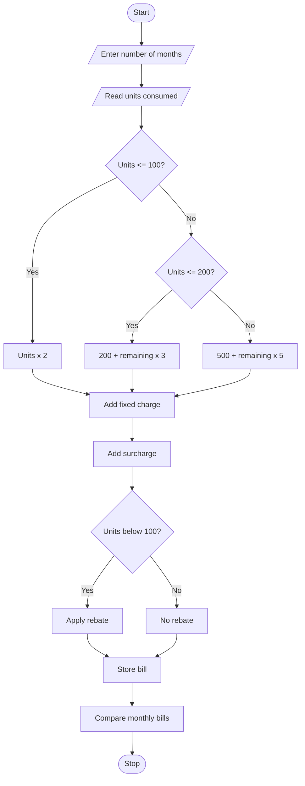

# PROGRAM 2: PROGRESSIVE ELECTRICITY BILLING
# 1. Problem Statement
Develop a Python program to calculate household electricity bills using multiple consumption slabs, fixed charges, surcharges and rebates.

The program should compare electricity bills across multiple months and identify unusual increases.

Tariff rules:
Consumption	Rate
First 100 units	₹2/unit
Next 100 units	₹3/unit
Above 200 units	₹5/unit

- Fixed charge = ₹50.
- Surcharge = 5%.
- Rebate = 10% for consumption below 100 units.
# 2. Algorithm
1. Start.
2. Read the number of months.
3. Read units consumed each month.
4. Calculate slab-wise electricity charges.
5. Add fixed charges.
6. Add 5% surcharge.
7. Apply 10% rebate if eligible.
8. Store monthly bills in a list.
9. Compare consecutive bills.
10. Identify increases greater than 50%.
11. Display the bills.
12. Stop.
# 3. Flowchart (Mermaid)

# 4. Complete Source Code
bills = []

n = int(input("Enter number of months: "))

for i in range(n):

    units = float(input("Enter units consumed: "))

    if units < 0:
        print("Invalid units")
        continue

    if units <= 100:
        energy = units * 2

    elif units <= 200:
        energy = 200 + (units - 100) * 3

    else:
        energy = 500 + (units - 200) * 5

    total = energy + 50

    total += total * 0.05

    if units < 100:
        total -= total * 0.10

    bills.append(total)

    print("Month", i + 1,
          "Bill: Rs.", round(total, 2))

print("\nBILL COMPARISON")

for i in range(1, len(bills)):

    increase = bills[i] - bills[i - 1]

    if increase > bills[i - 1] * 0.50:
        print("Unusual increase in month", i + 1)

    else:
        print("Month", i + 1, "Normal increase")
# 5. Sample Input
Enter number of months: 3
Enter units consumed: 80
Enter units consumed: 120
Enter units consumed: 250
# 6. Sample Output
Month 1 Bill: Rs. 198.45
Month 2 Bill: Rs. 325.5
Month 3 Bill: Rs. 840.0

BILL COMPARISON
Unusual increase in month 2
Unusual increase in month 3
# 7. Screenshot

