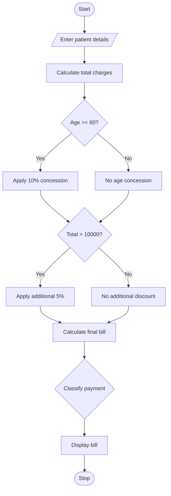

# PROGRAM 3: HOSPITAL BILLING AND PATIENT CLASSIFICATION
# 1. Problem Statement
Develop a Python program to calculate hospital bills using consultation, diagnostic and treatment charges.

Apply concessions based on patient age and bill amount. Classify patients according to their final payment amount.

Assumed rules:
- Senior citizens aged 60 or above receive 10% concession.
- Bills above ₹10,000 receive an additional 5% concession.
- Below ₹5,000: Low.
- ₹5,000–₹15,000: Medium.
- Above ₹15,000: High.
# 2. Algorithm
1. Start.
2. Read patient name and age.
3. Read consultation, diagnostic and treatment charges.
4. Validate the charges.
5. Calculate total bill.
6. Apply senior citizen concession.
7. Apply additional concession if eligible.
8. Calculate final payment.
9. Classify the patient.
10. Display the hospital bill.
11. Stop.
# 3. Flowchart (Mermaid)

# 4. Complete Source Code
name = input("Enter patient name: ")
age = int(input("Enter age: "))

consultation = float(input("Consultation charge: "))
diagnostic = float(input("Diagnostic charge: "))
treatment = float(input("Treatment charge: "))

if min(consultation, diagnostic, treatment) < 0:
    print("Invalid charges")

elif age < 0:
    print("Invalid age")

else:
    total = consultation + diagnostic + treatment

    discount = 0

    if age >= 60:
        discount += total * 0.10

    if total > 10000:
        discount += total * 0.05

    final_bill = total - discount

    if final_bill < 5000:
        category = "Low"

    elif final_bill <= 15000:
        category = "Medium"

    else:
        category = "High"

    print("\nHOSPITAL BILL")
    print("Patient:", name)
    print("Total:", total)
    print("Discount:", discount)
    print("Final Bill:", final_bill)
    print("Classification:", category)
# 5. Sample Input
Enter patient name: Rahul
Enter age: 65
Consultation charge: 1000
Diagnostic charge: 3000
Treatment charge: 8000
# 6. Sample Output
HOSPITAL BILL

Patient: Rahul
Total: 12000.0
Discount: 1800.0
Final Bill: 10200.0
Classification: Medium
# 7. Screenshot

