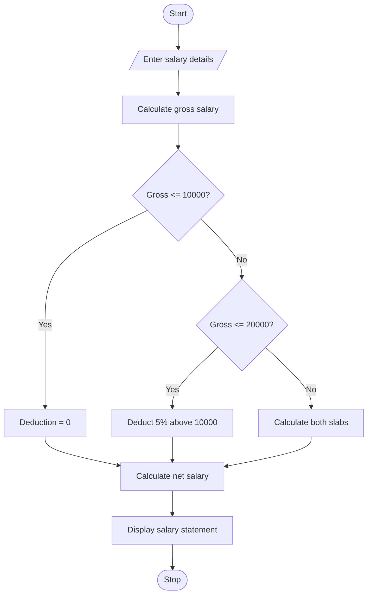

# PROGRAM 4: EMPLOYEE PAYROLL AND DEDUCTION ANALYSIS
# 1. Problem Statement
Develop a Python program to calculate employee salary using basic pay, allowances, overtime and incentives. Calculate gross salary, apply progressive deductions and generate a formatted salary statement.

Assumed deduction rules:
- First ₹10,000: No deduction.
- Next ₹10,000: 5% deduction.
- Above ₹20,000: 10% deduction.
# 2. Algorithm
1. Start.
2. Read employee name and basic salary.
3. Read allowances, overtime and incentives.
4. Calculate gross salary.
5. Calculate deductions using salary slabs.
6. Calculate net salary.
7. Display the salary statement.
8. Stop.
# 3. Flowchart (Mermaid)

# 4. Complete Source Code
name = input("Enter employee name: ")

basic = float(input("Enter basic salary: "))
allowance = float(input("Enter allowances: "))
overtime = float(input("Enter overtime amount: "))
incentive = float(input("Enter incentives: "))

if min(basic, allowance, overtime, incentive) < 0:
    print("Invalid salary details")

else:
    gross = basic + allowance + overtime + incentive

    if gross <= 10000:
        deduction = 0

    elif gross <= 20000:
        deduction = (gross - 10000) * 0.05

    else:
        deduction = 10000 * 0.05
        deduction += (gross - 20000) * 0.10

    net = gross - deduction

    print("\nSALARY STATEMENT")
    print("Employee:", name)
    print("Basic Salary:", basic)
    print("Gross Salary:", gross)
    print("Deduction:", deduction)
    print("Net Salary:", net)
# 5. Sample Input 
Enter employee name: Arjun
Enter basic salary: 20000
Enter allowances: 5000
Enter overtime amount: 2000
Enter incentives: 3000
# 6. Sample Output
SALARY STATEMENT

Employee: Arjun
Basic Salary: 20000.0
Gross Salary: 30000.0
Deduction: 1500.0
Net Salary: 28500.0
# 7. Screenshot

