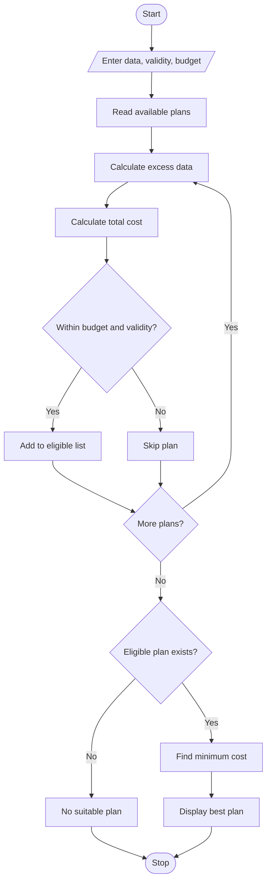

# PROGRAM 5: MULTI-PLAN TELECOMMUNICATIONS COST OPTIMIZATION
# 1. Problem Statement
Develop a Python program to compare multiple mobile recharge plans based on data usage, validity and budget. Calculate excess data charges and identify the most economical eligible plan.

Available plans:
Plan	Price	Data	Validity
Plan A	₹199	2 GB	28 days
Plan B	₹299	3 GB	28 days
Plan C	₹399	5 GB	56 days

Excess data charge = ₹20 per GB.
# 2. Algorithm
1. Start.
2. Read required data, validity and budget.
3. Store mobile plans in a list.
4. Calculate excess data for each plan.
5. Calculate total plan cost.
6. Check budget and validity.
7. Store eligible plans.
8. Select the minimum-cost plan.
9. Display the best plan.
10. Stop.
# 3. Flowchart (Mermaid)

# 4. Complete Source Code
plans = [
    ("Plan A", 199, 2, 28),
    ("Plan B", 299, 3, 28),
    ("Plan C", 399, 5, 56)
]

usage = float(input("Enter required data in GB: "))
days = int(input("Enter required validity: "))
budget = float(input("Enter budget: "))

eligible = []

if usage < 0 or days <= 0 or budget < 0:
    print("Invalid requirements")

else:
    for name, price, data, validity in plans:

        excess = max(0, usage - data)

        total = price + excess * 20

        if validity >= days and total <= budget:
            eligible.append((name, total))

    if eligible:
        best = min(eligible, key=lambda x: x[1])

        print("\nBEST MOBILE PLAN")
        print("Plan:", best[0])
        print("Total Cost: Rs.", best[1])

    else:
        print("No suitable plan available")
# 5. Sample Input
Enter required data in GB: 4
Enter required validity: 28
Enter budget: 450
# 6. Sample Output
BEST MOBILE PLAN

Plan: Plan A
Total Cost: Rs. 239
# 7. Screenshot

