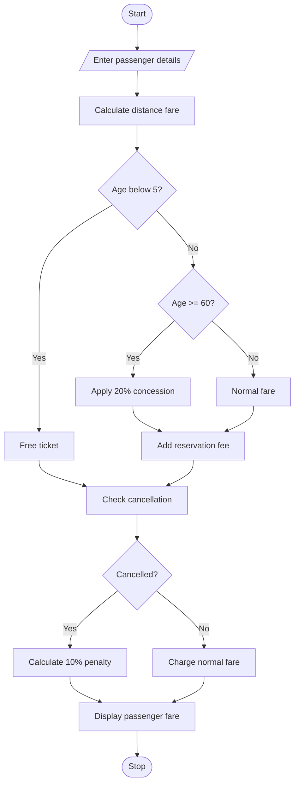

# PROGRAM 6: RAILWAY FARE AND RESERVATION CALCULATOR
# 1. Problem Statement
Develop a Python program to calculate railway fares for multiple passengers using distance slabs, travel classes, age-based concessions, reservation fees and cancellation penalties.

Assumed fare policy:
- Sleeper class: ₹1.50 per km.
- AC class: ₹3 per km.
- Children below 5 years: Free.
- Senior citizens aged 60 and above: 20% concession.
- Reservation fee: ₹50.
- Cancellation penalty: 10% of the ticket fare.
# 2. Algorithm
1. Start.
2. Read the number of passengers.
3. Read passenger age, distance and travel class.
4. Calculate base fare according to class.
5. Apply age-based concession.
6. Add reservation fee for passengers aged 5 or above.
7. Check cancellation status.
8. Calculate cancellation penalty if cancelled.
9. Display passenger-wise fare.
10. Calculate total amount.
11. Stop.
# 3. Flowchart (Mermaid)

# 4. Complete Source Code
n = int(input("Enter number of passengers: "))

total = 0

for i in range(n):

    print("\nPassenger", i + 1)

    age = int(input("Enter age: "))
    distance = float(input("Enter distance in km: "))
    travel_class = input("Enter class (Sleeper/AC): ")

    if age < 0 or distance < 0:
        print("Invalid details")
        continue

    if travel_class.lower() == "sleeper":
        rate = 1.5

    elif travel_class.lower() == "ac":
        rate = 3

    else:
        print("Invalid class")
        continue

    if age < 5:
        fare = 0

    else:
        fare = distance * rate

        if age >= 60:
            fare *= 0.80

        fare += 50

    cancel = input("Cancelled? (yes/no): ")

    if cancel.lower() == "yes":
        payable = fare * 0.10
    else:
        payable = fare

    total += payable

    print("Passenger Fare: Rs.", round(payable, 2))

print("\nTOTAL RAILWAY FARE:", round(total, 2))
# 5. Sample Input
Enter number of passengers: 2

Passenger 1
Enter age: 30
Enter distance in km: 200
Enter class (Sleeper/AC): Sleeper
Cancelled? (yes/no): no

Passenger 2
Enter age: 65
Enter distance in km: 200
Enter class (Sleeper/AC): AC
Cancelled? (yes/no): no
# 6. Sample Output
Passenger Fare: Rs. 350.0
Passenger Fare: Rs. 530.0

TOTAL RAILWAY FARE: 880.0
# 7. Screenshot

