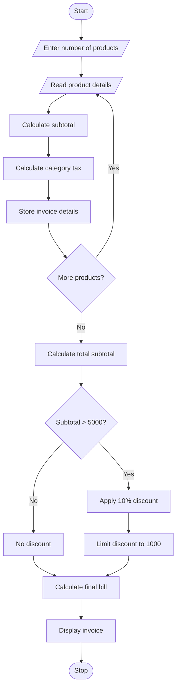

# PROGRAM 7: RETAIL BILLING WITH MULTIPLE DISCOUNT RULES
# 1. Problem Statement
Develop a Python program to generate a retail invoice for multiple products. Calculate product prices, quantities, category-specific taxes, threshold discounts and maximum concession limits.

Assumed rules:
Category	Tax
Electronics	18%
Clothing	5%
Other products	12%

- Purchase above ₹5,000 receives a 10% discount.
- Maximum discount = ₹1,000.
# 2. Algorithm
1. Start.
2. Read the number of products.
3. Read product name, category, price and quantity.
4. Calculate product subtotal.
5. Calculate category-specific tax.
6. Add subtotal and tax to the invoice.
7. Check whether subtotal exceeds ₹5,000.
8. Apply 10% discount.
9. Limit the discount to ₹1,000.
10. Calculate final amount.
11. Display the itemized invoice.
12. Stop.
# 3. Flowchart (Mermaid)

# 4. Complete Source Code
n = int(input("Enter number of products: "))

subtotal = 0
tax_total = 0

if n <= 0:
    print("Invalid number of products")

else:
    for i in range(n):

        print("\nProduct", i + 1)

        name = input("Enter product name: ")
        category = input("Enter category: ").lower()

        price = float(input("Enter price: "))
        quantity = int(input("Enter quantity: "))

        if price < 0 or quantity <= 0:
            print("Invalid product details")
            continue

        amount = price * quantity

        if category == "electronics":
            tax_rate = 0.18

        elif category == "clothing":
            tax_rate = 0.05

        else:
            tax_rate = 0.12

        tax = amount * tax_rate

        subtotal += amount
        tax_total += tax

        print(name, "Amount:", amount, "Tax:", tax)

    discount = 0

    if subtotal > 5000:
        discount = min(subtotal * 0.10, 1000)

    final = subtotal + tax_total - discount

    print("\nRETAIL INVOICE")
    print("Subtotal:", subtotal)
    print("Tax:", tax_total)
    print("Discount:", discount)
    print("Final Amount:", round(final, 2))
# 5. Sample Input
Enter number of products: 2

Product 1
Enter product name: Laptop
Enter category: electronics
Enter price: 4000
Enter quantity: 1

Product 2
Enter product name: Shirt
Enter category: clothing
Enter price: 2000
Enter quantity: 1
# 6. Sample Output
Laptop Amount: 4000.0 Tax: 720.0
Shirt Amount: 2000.0 Tax: 100.0

RETAIL INVOICE
Subtotal: 6000.0
Tax: 820.0
Discount: 600.0
Final Amount: 6220.0
# 7. Screenshot

