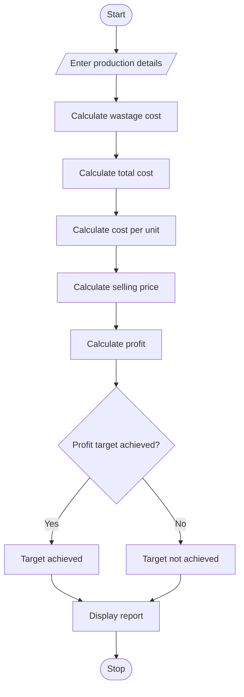

# PROGRAM 8: MANUFACTURING COST AND PROFITABILITY ANALYSIS
# 1. Problem Statement
Develop a Python program to calculate manufacturing costs, including material costs, labour charges, wastage and machine expenses.

Calculate total production cost, selling price and expected profit. Check whether the production meets the specified profit target.

Assumed rules:
- Wastage cost = 5% of material cost.
- Profit target = 20% of total production cost.
# 2. Algorithm
1. Start.
2. Read material, labour and machine costs.
3. Read production quantity.
4. Calculate wastage cost.
5. Calculate total manufacturing cost.
6. Calculate cost per product.
7. Calculate selling price with 20% profit.
8. Calculate expected profit.
9. Check profit target.
10. Display manufacturing report.
11. Stop.
# 3. Flowchart (Mermaid)

# 4. Complete Source Code
material = float(input("Enter material cost: "))
labour = float(input("Enter labour cost: "))
machine = float(input("Enter machine cost: "))

quantity = int(input("Enter production quantity: "))

if min(material, labour, machine) < 0 or quantity <= 0:
    print("Invalid production details")

else:
    wastage = material * 0.05

    total_cost = material + labour + machine + wastage

    cost_per_unit = total_cost / quantity

    selling_price = cost_per_unit * 1.20

    revenue = selling_price * quantity

    profit = revenue - total_cost

    print("\nMANUFACTURING REPORT")

    print("Wastage Cost:", wastage)
    print("Total Cost:", total_cost)

    print("Cost Per Unit:", round(cost_per_unit, 2))

    print("Selling Price:", round(selling_price, 2))

    print("Expected Profit:", round(profit, 2))

    if profit >= total_cost * 0.20:
        print("Profit Target Achieved")

    else:
        print("Profit Target Not Achieved")
# 5. Sample Input
Enter material cost: 10000
Enter labour cost: 3000
Enter machine cost: 2000
Enter production quantity: 100
# 6. Sample Output
MANUFACTURING REPORT

Wastage Cost: 500.0
Total Cost: 15500.0
Cost Per Unit: 155.0
Selling Price: 186.0
Expected Profit: 3100.0

Profit Target Achieved
# 7. Screenshot

 I --> K[Display report]
 J --> K
 K --> L([Stop])
