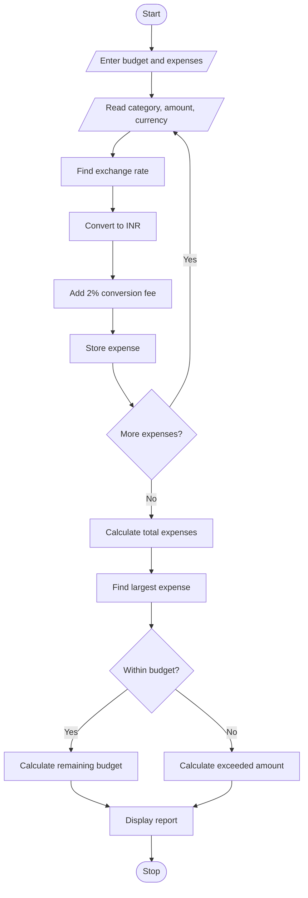

# PROGRAM 9: MULTI-CURRENCY TRAVEL BUDGET ANALYSIS
# 1. Problem Statement
Develop a Python program to calculate travel expenses in different currencies using supplied exchange rates.

Include conversion fees, compare total spending against the available budget and identify the largest expense category.

Assumed exchange rates:
Currency	Exchange rate
USD	₹84
EUR	₹90
GBP	₹105
INR	₹1

Currency conversion fee = 2%.
# 2. Algorithm
1. Start.
2. Read the travel budget in INR.
3. Read the number of expense categories.
4. Read category name, amount and currency.
5. Retrieve the corresponding exchange rate.
6. Convert the amount into INR.
7. Calculate the 2% conversion fee.
8. Store the converted expense.
9. Calculate total expenses.
10. Identify the largest expense.
11. Compare expenses with the budget.
12. Display the travel report.
13. Stop.
# 3. Flowchart (Mermaid)

 # 4. Complete Source Code
 rates = {
    "USD": 84,
    "EUR": 90,
    "GBP": 105,
    "INR": 1
}

budget = float(input("Enter budget in INR: "))

n = int(input("Enter number of expenses: "))

expenses = []

if budget < 0 or n <= 0:
    print("Invalid details")

else:
    for i in range(n):

        print("\nExpense", i + 1)

        category = input("Enter category: ")

        amount = float(input("Enter amount: "))

        currency = input("Enter currency: ").upper()

        if amount < 0 or currency not in rates:
            print("Invalid expense details")
            continue

        converted = amount * rates[currency]

        fee = converted * 0.02

        total = converted + fee

        expenses.append((category, total))

    if expenses:

        total_expense = sum(x[1] for x in expenses)

        largest = max(expenses, key=lambda x: x[1])

        print("\nTRAVEL BUDGET REPORT")

        print("Total Expenses:", round(total_expense, 2))

        print("Largest Expense:", largest[0])

        if total_expense <= budget:

            print("Remaining Budget:",
                  round(budget - total_expense, 2))

            print("Budget Status: Within Budget")

        else:

            print("Exceeded Amount:",
                  round(total_expense - budget, 2))

            print("Budget Status: Exceeded")

    else:
        print("No valid expenses entered")
# 5. Sample Input
Enter budget in INR: 100000
Enter number of expenses: 3

Expense 1
Enter category: Hotel
Enter amount: 300
Enter currency: USD

Expense 2
Enter category: Food
Enter amount: 200
Enter currency: EUR

Expense 3
Enter category: Shopping
Enter amount: 100
Enter currency: GBP
# 6. Sample Output

 TRAVEL BUDGET REPORT

Total Expenses: 54774.0
Largest Expense: Hotel
Remaining Budget: 45226.0
Budget Status: Within Budget
# 7. Screenshot

